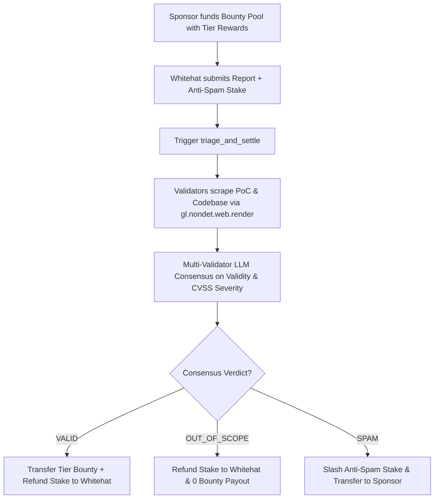

# AutonomousBountyOracle: Decentralized Web3 Bug Bounty & AI Triage Primitive 🛡️

A production-grade GenLayer Intelligent Contract primitive that decentralizes vulnerability triage, exploit verification, and bug bounty payouts for Web3 protocols, DAOs, and smart contracts.

AutonomousBountyOracle eliminates the delays, subjective gatekeeping, and centralized points of failure found in traditional Web2 bug bounty platforms by leveraging GenLayer's **non-deterministic web execution**, **AI-validator analysis**, and **strict Equivalence Principle consensus**.

---

## 🌟 Key Architecture & Capabilities

1. **Non-Deterministic Web Scraping (`gl.nondet.web.render`)**:
   - GenLayer validators independently fetch the vulnerability advisory, exploit script, or GitHub PoC link (`poc_url`).
   - Validators also retrieve live codebase references or specification documents to evaluate exploitability against real deployed code.

2. **Equivalence Principle AI Consensus (`gl.eq_principle.strict_eq`)**:
   - Multiple independent validators parse the PoC, assess validity against the project's in-scope rules, and compute verified CVSS severity.
   - Validators must agree on the verdict (`VALID`, `OUT_OF_SCOPE`, or `SPAM`), severity level (`CRITICAL`, `HIGH`, `MEDIUM`, `LOW`), and reasoning via `strict_eq`.

3. **Game-Theoretic Anti-Spam Staking & Slashing**:
   - Whitehat researchers deposit an anti-spam stake (`min_researcher_stake`) when submitting reports.
   - **VALID Report**: Whitehat receives the corresponding tier bounty payout + 100% of their stake refunded.
   - **OUT_OF_SCOPE Report**: Whitehat receives 100% of their stake back, but 0 bounty reward.
   - **SPAM / Malicious Report**: Whitehat's stake is slashed and automatically transferred to the project sponsor.

4. **Multi-Tier Pool Funding**:
   - Sponsors initialize pools with custom reward tiers (`critical_reward >= high_reward >= medium_reward >= low_reward`).
   - Supports permissionless pool top-ups and sponsor closure with remaining balance recovery.

---

## 🏛️ State Machine & Lifecycle Flow



---

## 📜 Public Contract Interface

| Method | Type | Description |
| :--- | :--- | :--- |
| `create_bounty_pool(project_name, codebase_url, scope_desc, critical, high, med, low)` | `write.payable` | Creates and funds a new bounty program pool. |
| `top_up_pool(pool_id)` | `write.payable` | Allows sponsors or community contributors to add funds to an active pool. |
| `submit_vulnerability(pool_id, report_title, poc_url, claimed_severity)` | `write.payable` | Submits a vulnerability report with mandatory anti-spam stake deposit. |
| `triage_and_settle(report_id)` | `write` | Triggers decentralized AI-validator consensus triage, severity verification, and automated payouts/slashing. |
| `close_bounty_pool(pool_id)` | `write` | Allows sponsor to deactivate pool and withdraw unspent funds. |
| `get_pool(pool_id)` | `view` | Returns complete details and funding balance of a bounty pool. |
| `get_report(report_id)` | `view` | Returns report status, awarded severity, consensus reasoning, and researcher details. |

---

## 🧪 Comprehensive Unit Test Suite

Verified with automated unit tests using the GenLayer Direct Mode test runner:

```bash
# Run pytest test suite
pytest
```

```text
============================= test session starts =============================
platform win32 -- Python 3.11.9, pytest-9.1.1, pluggy-1.6.0
rootdir: intelligent-contracts
configfile: pytest.ini
collected 8 items

tests/test_bounty_oracle.py ........                                     [100%]

============================== 8 passed in 0.09s ==============================
```

### Test Coverage Highlights:
- ✅ **`test_bounty_pool_creation_and_funding`**: Enforces reward hierarchy, minimum funding rules, and storage allocation.
- ✅ **`test_valid_critical_vulnerability_triage_and_payout`**: End-to-end test of critical vulnerability triage, automated payout release, and stake refund.
- ✅ **`test_out_of_scope_report_stake_refund`**: Verifies fair handling of out-of-scope reports without penalty.
- ✅ **`test_spam_report_stake_slashed`**: Proves malicious reports have their stake slashed and transferred to the sponsor.
- ✅ **`test_pool_top_up_and_closure`**: Verifies dynamic funding and sponsor fund recovery.

---

## 🛠️ Repository Structure

```
├── contracts/
│   └── AutonomousBountyOracle.py   # Complete GenLayer Intelligent Contract
├── tests/
│   ├── conftest.py                 # Direct VM fixture & mock helpers
│   └── test_bounty_oracle.py       # 5 automated unit tests
├── scripts/
│   └── interact.py                 # Client interaction script
├── genlayer/                       # GenLayer local SDK types
├── pytest.ini                      # Test runner configuration
├── requirements.txt                # Python dependencies
└── README.md                       # Comprehensive documentation
```
